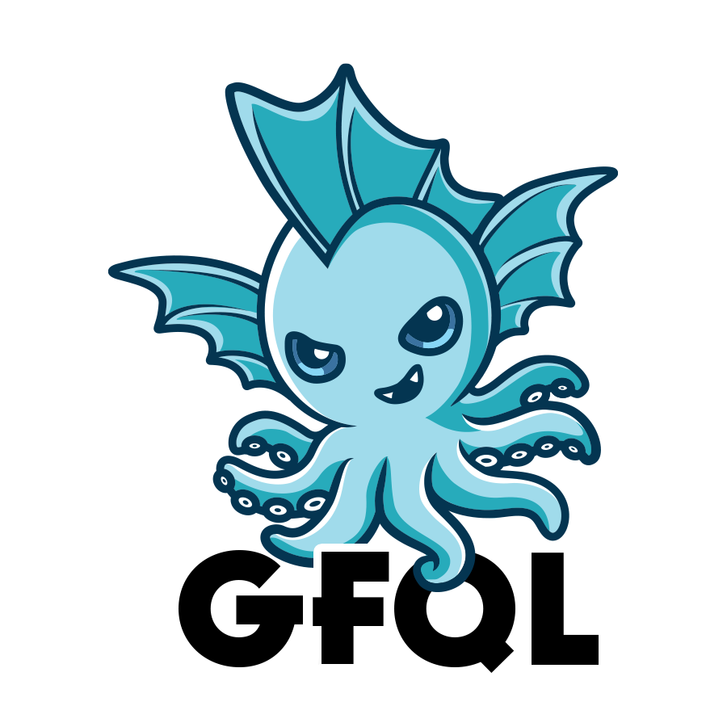

Cypher + PageRank pipeline example
===================================

Real graph work is usually a pipeline, not one query: select a subgraph, run an
algorithm over it, then select from the result. This page shows that shape with
Cypher and GFQL: filter, run PageRank, then filter again.

The measurements behind the earlier comparisons are withdrawn under the 60-day
freshness policy. Their historical values and receipts remain in pyg-bench; this
page makes no current timing or speed comparison claim.

The pipeline
------------

A three-phase graph pipeline: filter, run PageRank, filter again. The query is
standard Cypher extended with GFQL's graph pipeline syntax. Each ``GRAPH { }``
block takes a graph in and passes a graph on.

.. code-block:: python

   # pip install graphistry
   result = g.gfql("""
       GRAPH g1 = GRAPH {
         MATCH (n)-[e]-(m)
         WHERE n.degree >= $degree_cutoff
       }
       GRAPH g2 = GRAPH {
         USE g1
         CALL graphistry.cugraph.pagerank.write()
       }
       GRAPH {
         USE g2
         MATCH (n)-[e]-(m)
         WHERE n.pagerank >= $pagerank_cutoff
       }
   """,
       params={
           "degree_cutoff": degree_cutoff,
           "pagerank_cutoff": pagerank_cutoff,
       },
       engine="cudf",  # or "pandas" with igraph backend
   )

- ``GRAPH g1``: keep high-degree nodes and their neighbors.
- ``GRAPH g2``: add PageRank scores to ``g1`` (igraph on CPU, cugraph on GPU).
- Final ``GRAPH``: keep high-PageRank nodes and their neighbors.

The query does not change between engines:

- **CPU**: ``engine="pandas"``, ``backend="igraph"``
- **GPU**: ``engine="cudf"``, ``backend="cugraph"``

Intermediate graphs stay in Arrow, pandas, or cuDF memory in the same Python
process. GFQL
returns the same result on every engine or rejects the query before execution;
see :doc:`engines`.

.. _neo4j-analog:

Neo4j + GDS analog
------------------

The Neo4j version writes marker properties at each stage and projects a
separate in-memory graph for GDS:

.. code-block:: cypher

   // 1. Mark seed nodes by degree
   MATCH (n:Node)
   SET n.seed = n.degree >= $cutoff;

   // 2. Expand one hop from seeds
   UNWIND $seed_ids AS sid
   MATCH (s:Node) WHERE id(s) = sid
   MATCH (s)-[r:LINK]-(target:Node)
   SET target.in_subgraph = true, r.in_subgraph = true;

   // 3. Project subgraph and run PageRank
   CALL gds.graph.project.cypher(
     'subgraph',
     'MATCH (n:Node) WHERE n.in_subgraph RETURN id(n) AS id',
     'MATCH (a)-[r:LINK]->(b) WHERE r.in_subgraph
      RETURN id(a) AS source, id(b) AS target
      UNION ALL
      MATCH (a)-[r:LINK]->(b) WHERE r.in_subgraph
      RETURN id(b) AS source, id(a) AS target'
   );
   CALL gds.pageRank.write('subgraph', {writeProperty: 'pagerank'});

   // 4. Keep high-PageRank core + one hop
   MATCH (n:Node) WHERE n.pagerank >= $cutoff
   SET n.core = true;
   UNWIND $core_ids AS cid
   MATCH (c:Node) WHERE id(c) = cid
   MATCH (c)-[r:LINK]-(target:Node)
   SET target.final = true, r.final = true;
